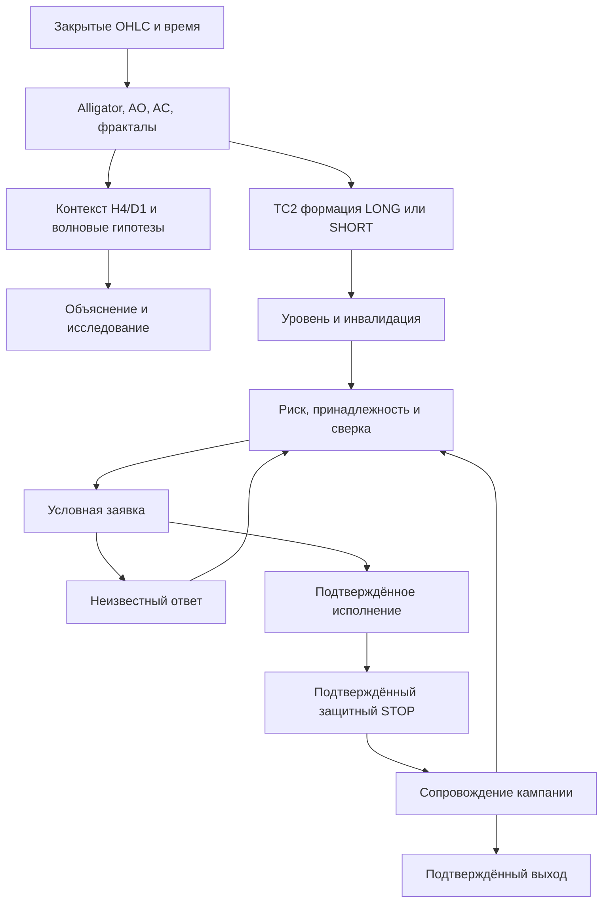

# Зависимости правил и торговых состояний

Граф — спецификация контроля, не доказательство исправности всей цепочки.

Обязательные зависимости: закрытие сигнального бара, два правых подтверждения
фрактала, реальный tick, актуальный ценовой триггер, риск, принадлежность
кампании, проверяемый результат запроса и защита фактически исполненного объёма.
H4/D1/волновой score не становятся универсальным обязательным согласованием TC2.

Одновременные события: сначала сохранить наблюдения обоих направлений,
раздельно определить формации и триггеры. Противоречие не разрешается суммой
голосов. Пример EN175: один бар может исполнить WM3 и сформировать противоположный
WM1; последний ещё требует следующего ценового пробоя. Частичные/неизвестные
ордера нельзя трактовать как свободный слот для противоположного входа.

Все новые наблюдательные правила идут в объяснения/гипотетические кампании,
без ребра к отправке ордера. AI не получает ребра к Execution.
